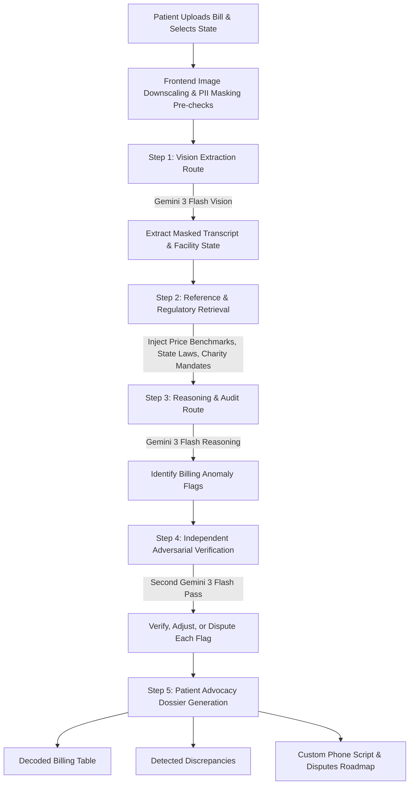

# 🛡️ MediAudit AI


> A **Crisis-to-Action Translator** for U.S. patients navigating complex, opaque medical bills.

---

## 📖 Overview
MediAudit AI empowers patients by analyzing medical bills to uncover discrepancies, decode terminology, and generate clear advocacy paths. When a user uploads photos or a PDF of an itemized hospital statement (up to 30 pages) and selects their state, MediAudit AI runs a grounded, self-verifying Gemini 3 Flash pipeline.

### The Auditing Pipeline


### Detailed Pipeline Steps
1. **Reads** the billing image or PDF using vision, transcribing every line item while masking patient identifiers (such as name, DOB, SSN, MRN, and account number) and detecting the facility's state to auto-localize the audit.
2. **Decodes** cryptic billing shorthand, CPT codes, and HCPCS codes into plain English.
3. **Cross-references** charges against a curated reference layer of illustrative price anchors and coding or bundling rules. The pipeline audits for three institutional error patterns (upcoding, duplicate billing, and unbundled supply fees) and runs an independent second-pass verifier through a separate Gemini call. This verifier adversarially re-checks every flag against the transcript to confirm, recalibrate, or dispute the findings.
4. **Localizes** relevant consumer protections, including state laws, non-profit charity care mandates, and the Federal No Surprises Act.
5. **Generates** a polite but firm patient advocacy phone script, an estimated fair-market range for flagged charges, and a low-stress, step-by-step roadmap to dispute the bill.

The intelligence backend is powered by **Gemini 3 Flash (`gemini-3-flash-preview`)** across all passes (vision reading, reasoning, and verification), guided by the persona, workflow, and strict compliance constraints in [[master-prompt.md](./master-prompt.md)].

---

## 🛠️ Tech Stack
- **Next.js 15** (App Router) · **React 19** · **TypeScript**
- **`@google/genai`**: Enables structured JSON output, vision input for image/PDF reading, and a configurable thinking level.
- **Bespoke CSS**: Custom editorial-forensic styling with no UI framework, featuring Fraunces, Hanken Grotesk, and IBM Plex Mono fonts.

Both model calls use `responseMimeType: "application/json"` with a specific `responseSchema` (structured JSON). The vision pass returns a masked transcript and the detected region, while the audit pass generates the five-section advocacy packet. The frontend UI renders this structured output into an accessible, responsive dossier. To keep requests fast, images are downscaled in the browser prior to upload.

---

## 🚀 Run It Locally

### 1. Configure Environment Variables
Copy the template and add your Google Gemini API key (available at [Google AI Studio](https://aistudio.google.com/apikey)):
```bash
cp .env.example .env.local
```
Edit `.env.local` and paste your key into the `GEMINI_API_KEY` variable.

### 2. Install & Start the App
```bash
npm install
npm run dev
```
Open [http://localhost:3000](http://localhost:3000) in your browser. You can click **"Try a sample bill"** to see it in action or upload your own statement, pick a state, and run the audit.

The **"Try an oncology bill"** button uses a fictional, masked outpatient infusion statement to demonstrate how a patient or caregiver can prepare billing questions. This was added for CodeTheCure in October 2026; the underlying MediAudit AI project predates the event. The tool does not assess whether cancer treatment is medically necessary, verify drug doses or insurance coverage, or replace clinical or billing professionals.

> [!NOTE]
> The audit runs Gemini 3 Flash at a low thinking level, so a full analysis typically takes 10 to 30 seconds. The request runs server-side with a 120-second `maxDuration` threshold, and the browser aborts after 115 seconds as a safety net.

---

## 🗂️ Project Architecture

| File Path | Role |
| :--- | :--- |
| [master-prompt.md](./master-prompt.md) | Canonical product behavior: the single source of truth for the persona, workflow, and constraints. |
| [lib/system-prompt.ts](./lib/system-prompt.ts) | Verbatim integration of the master prompt; manages audit, vision-extraction, and independent verifier prompts, along with the retrieval/reasoning protocol and JSON schemas. |
| [lib/reference.ts](./lib/reference.ts) | The retrieval layer: maps curated, illustrative price anchors and coding/bundling rules to ground each flagged charge, marking them as `reference-table` or `model-estimate`. |
| [app/api/extract/route.ts](./app/api/extract/route.ts) | Vision pass API endpoint: processes uploaded files via `gemini-3-flash-preview` to return a masked transcript and detected region. |
| [app/api/audit/route.ts](./app/api/audit/route.ts) | Reasoning and verification endpoint: runs the reasoning pass, invokes the adversarial second-pass verifier, and merges the calibrated verdicts (confirm, adjust, dispute) into the final response. |
| [lib/types.ts](./lib/types.ts) | Shared TypeScript type definitions mirroring the API response schemas. |
| [lib/sample.ts](./lib/sample.ts) | Seeded mock ER statement (fully masked) containing all three primary billing error patterns for testing. |
| [app/page.tsx](./app/page.tsx) | Main page component containing the hero section, upload console, analysis state animations, and the advocacy dossier renderer. |
| [app/globals.css](./app/globals.css) | Custom CSS styles defining the unique "editorial forensic" typography and design system. |

---

## 🛡️ Privacy & Scope

* **Data Masking:** Patient identifiers (such as names, DOBs, SSNs, MRNs, and account numbers) are expected to be masked on-device prior to submission. The application does not collect personal identifiers, and the underlying AI models are explicitly instructed not to reconstruct them.
* **No Persistence:** No statement text or uploaded document content is stored permanently; all data is sent to the models solely to process the current audit request.
* **Educational Purpose:** MediAudit AI is an automated informational tool. It does not provide legal counsel, medical advice, or financial planning, and it never asserts that any charge is illegal. It highlights potential billing discrepancies and benchmark deviations to help patients verify them against physical records.
* **Estimates Only:** Price benchmark ranges and confidence scores are AI estimates derived from the model's trained knowledge of typical U.S. healthcare pricing. They do not represent a real-time lookup of any specific hospital's chargemaster or public Medicare databases. Every flag should be treated as a point of verification rather than definitive proof of error.

---

## 📦 Deployment

This application can be deployed on any standard Node.js hosting platform. 

For **Vercel**:
1. Import the repository.
2. Define the `GEMINI_API_KEY` environment variable.
3. Deploy the project.

*(Note: The API routes specify a `maxDuration` of 120 seconds. Vercel Pro accounts honor this threshold, while Hobby accounts cap execution at 60 seconds.)*
